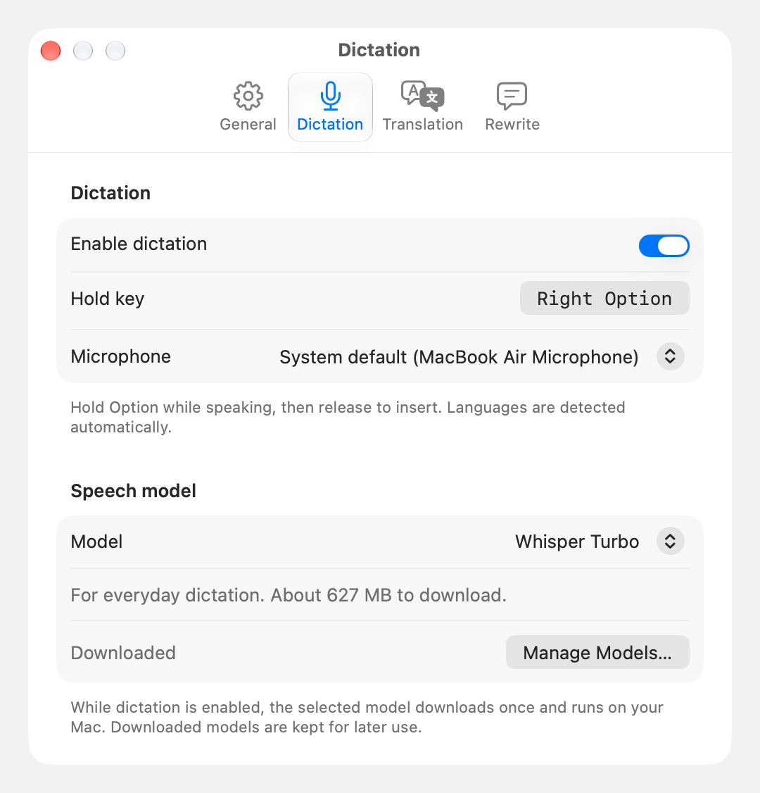

# Translate Like Me

**Dictate, improve, and translate. Still sound like you.**

One small Mac app for getting from a thought to a message you can send.
Speak or type, turn rough wording into clear text, and translate it when you
need another language. Your writing style carries through rewriting and
translation.

It works where you write. Hold a key to dictate at the cursor, or select text
and press a shortcut to improve or translate it in place. The app lives in the
menu bar, ready when you need it.

[Download for macOS](https://github.com/wiltodelta/translate-like-me/releases/latest)
· [Website](https://translatelikeme.com)
· [User guide](docs/user-guide.md)

[](https://github.com/wiltodelta/translate-like-me/actions/workflows/build.yml)

<p align="center">
  <picture>
    <source media="(prefers-color-scheme: dark)" srcset="screenshots/menu-dark.png">
    
  </picture>
</p>

## Get started

Requires **macOS 15 or later** on a Mac with **Apple silicon**.

```bash
brew install --cask wiltodelta/tap/translate-like-me
```

Or [download the latest release](https://github.com/wiltodelta/translate-like-me/releases/latest),
unzip it, and move **Translate Like Me.app** to `/Applications`. Releases are
signed and notarized. Updates arrive in the app and install when you choose.

First launch recommends languages from macOS and enabled keyboards, then prepares
two local models for your Mac. Download and verification must finish before
continuing. Next, grant **Microphone** and **Accessibility** access; the final
screen explains dictation and translation with your actual shortcuts. Downloads
can be paused and resumed. Models and other options stay editable in Settings.
A new profile also gets a neutral Improve Text preset. Cloud engines remain
optional alternatives that need their official CLI installed and signed in.

## Speak first, polish afterwards

Hold **Right Option**, say what you want to write, and release to insert the
transcript at your cursor. Languages are detected automatically. Speech
recognition runs locally on your Mac and works offline after setup.

Dictate a quick reply as it is, or get a longer thought down without worrying
about wording. When it needs editing, select the transcript and use **Rewrite**.

<p align="center">
  <picture>
    <source media="(prefers-color-scheme: dark)" srcset="screenshots/dictation-dark.png">
    
  </picture>
</p>

## Make it clear. Keep it yours.

Select rough notes or a draft and press a **Rewrite** shortcut. It turns them
into a finished message in the same language, guided by your writing style.
You can also select a received message together with your notes to draft a reply.

A style can be as simple as “Clear and polite, short paragraphs.” Create a
preset for work, another for friends, or use an empty style for a neutral
rewrite. New profiles include **Improve Text** on **⌥⌘J**. Customize it or add
more presets in **Settings > Rewrite**.

Rewrite is instructed to remove filler and repetition, resolve self-corrections,
and preserve your facts and questions for the recipient.

<p align="center">
  <picture>
    <source media="(prefers-color-scheme: dark)" srcset="screenshots/rewrite-dark.png">
    
  </picture>
</p>

## Another language. The same voice.

Select text and press your language pair's shortcut. The translation replaces
it in place. Write in either language: the direction is detected automatically.
The first pair starts on **⌥⌘F**.

Give a pair a writing style to make translations sound like you. Leave it empty
for a plain translation, useful when reading someone else's words. You can keep
up to three pairs, each with its own style and shortcut.

Use translation on its own, or after Rewrite to send a polished message in
another language.

<p align="center">
  <picture>
    <source media="(prefers-color-scheme: dark)" srcset="screenshots/general-dark.png">
    
  </picture>
</p>

Screenshots use sample settings and include light and dark versions.

## Use a local model or an account you already have

Dictation runs locally with Whisper or Qwen3-ASR, with no account or API key.
For translation and Rewrite, choose a local model or use Claude Code, Codex,
Grok Build, or Antigravity through its official CLI.

Local translation works offline after the model download. CLI engines use the
account you are signed in to, subject to the provider's plan limits and terms.
You can keep the CLI's default model and effort settings.

<details>
<summary>Engine options and local model requirements</summary>

| Engine | Runs through |
| --- | --- |
| Claude Code | `claude` |
| Codex | `codex` |
| Grok Build | `grok` |
| Antigravity | `agy` |
| Local translation | MLX, inside the app |

Fresh profiles select **Gemma 4 E2B** on Macs with **8-16 GB** of memory and
**TranslateGemma 12B** above **16 GB**. Dictation selects **Whisper Turbo**
through **16 GB** and **Qwen3-ASR** above that. Existing model choices are
preserved. TranslateGemma can also be selected manually on a 16 GB Mac.
The lighter model has more limitations in translation and Rewrite. See the
[setup instructions and model comparison](docs/user-guide.md#providers).

</details>

## Your text stays under your control

- **Local dictation.** Speech is recognized on your Mac. Temporary audio is
  deleted after recognition or cancellation.
- **A choice of where text goes.** Local translation keeps the text and style
  on your Mac. Cloud engines receive them through their official CLI. The app
  has no server, analytics, or telemetry.
- **A protected clipboard.** The original clipboard is restored after insertion.
  Anything you copy while the app works is preserved.
- **A result you can recover.** If you switch apps or insertion cannot be
  confirmed, a popup offers the result to copy. **Copy Last Result** keeps
  Translation, Rewrite, and Dictation separately until you quit.

CLI history behavior varies. See the [privacy details](docs/user-guide.md#privacy).

## At home on your Mac

Native SwiftUI and AppKit controls, light and dark appearances, global shortcuts,
and no Dock icon. The interface follows your Mac's language and is available
in English, Russian, German, French, Spanish, Japanese, Simplified Chinese,
Brazilian Portuguese, Italian, and Korean.

## Build from source

Requires **Xcode 26 or later** with **Swift 6.3 or later**.

```bash
git clone https://github.com/wiltodelta/translate-like-me.git
cd translate-like-me
./build.sh
open "Translate Like Me Dev.app"
```

The development app has its own settings and permissions. Without the
maintainer's Developer ID in your keychain, it is signed ad hoc and macOS may
ask for Accessibility again after rebuilding.

Run `bash maintain.sh` for lint, tests, and bundle assembly.
`./capture-screenshots.sh` regenerates both sets of screenshots; it requires
Accessibility, Screen Recording, and an unlocked Mac left alone during capture.

[User guide](docs/user-guide.md) ·
[Build and release](docs/build-and-release.md) ·
[Product direction](docs/product-direction.md)

## License

[Apache License 2.0](LICENSE). Dependencies and model weights have their own
licenses and notices.
