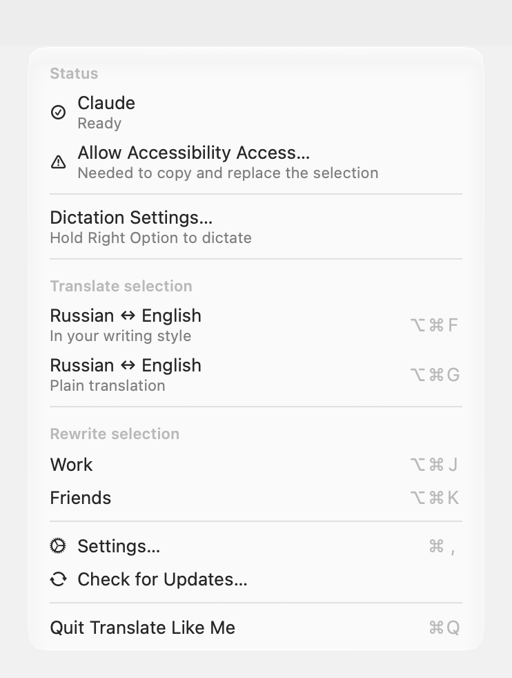
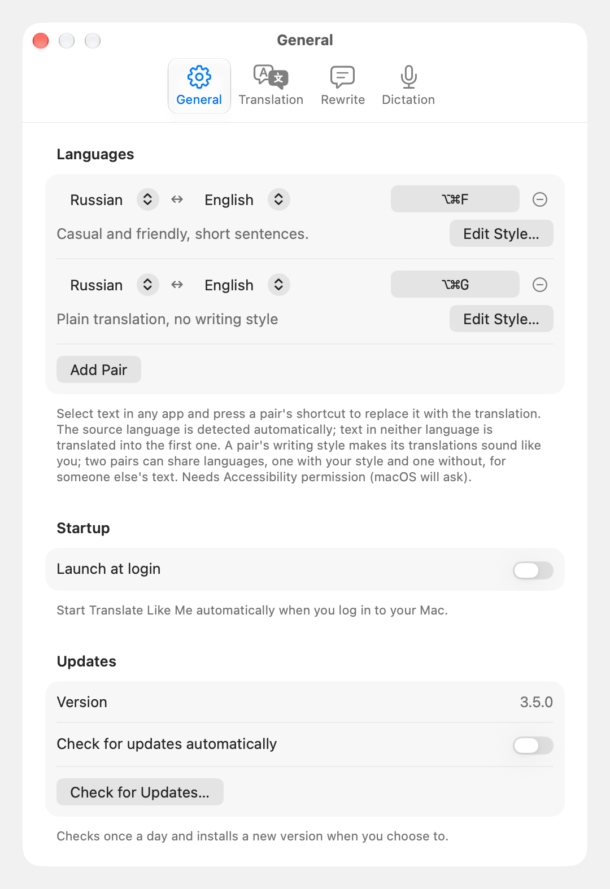
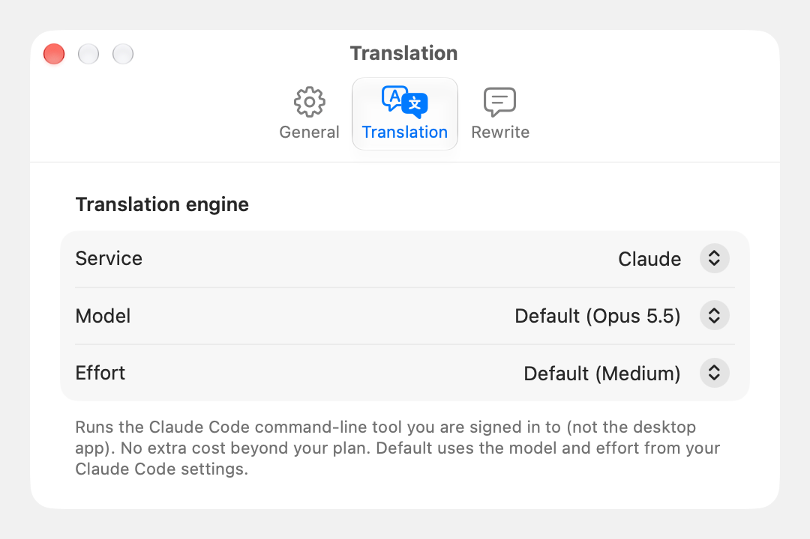
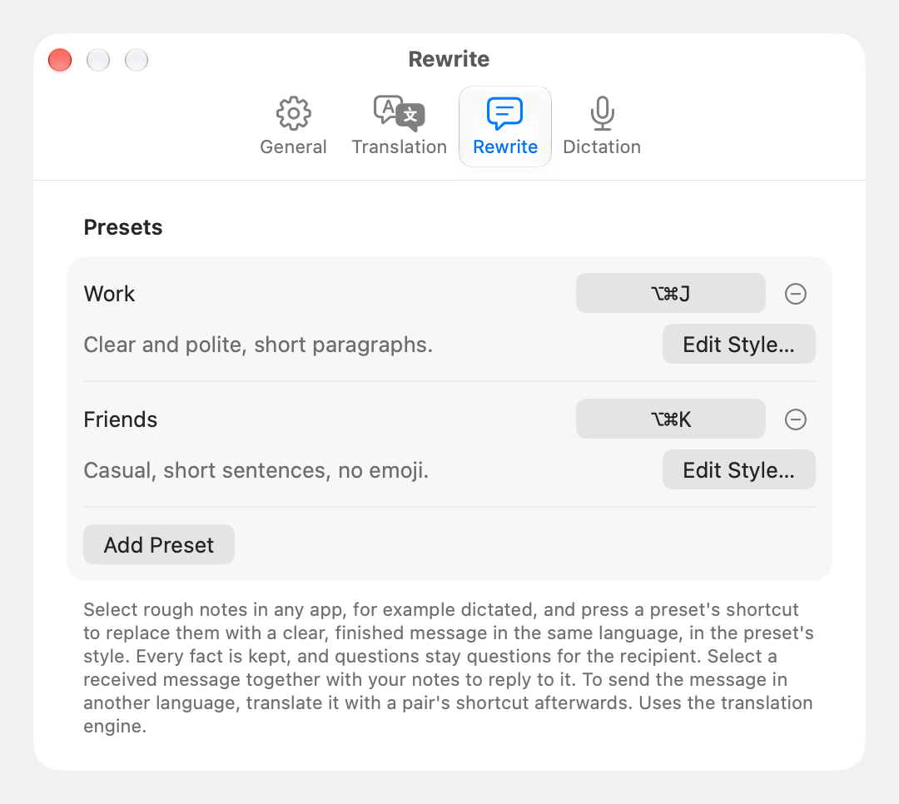

# Translate Like Me

[](https://github.com/wiltodelta/translate-like-me/actions/workflows/build.yml)

A tiny macOS menu-bar app that translates the current selection with a global
hotkey and rewrites it in your own writing style. Select text in any app, press
the shortcut, and the selection is replaced in place with the translation.
Website: [translatelikeme.com](https://translatelikeme.com).

It detects the direction automatically between the two languages you choose, so
there is nothing to switch: type in one, get the other. If you use more languages,
set up to three pairs, each on its own shortcut.

It also writes for you: select rough notes, for example dictated, press a
Rewrite preset's shortcut, and they are replaced with a clear, finished message
in the same language, in that preset's style.

Local dictation adds speech at the cursor: enable it in Settings > Dictation,
allow microphone access, and let the speech model download once. Hold the
right Option key while speaking, then release to insert. Languages are detected automatically.

<p align="center">
  
  
  
  
</p>

## Features

- **Translate in place**: replaces the selected text directly, in any app.
- **Automatic direction**: detects which language of the pair you wrote in and
  translates to the other; text in any other language goes to the pair's first.
- **Up to three language pairs**: for example Russian ↔ English on ⌥⌘F and
  Russian ↔ Spanish on ⌥⌘G.
- **Your writing style, per pair**: an optional style description makes a
  pair's translations sound like you. Two pairs can share languages, for
  example one with your style for your own text and a plain one for someone
  else's.
- **Rewrite notes into a message**: up to three named presets, each with its
  own shortcut and writing style, for example Work on ⌥⌘J and Friends on ⌥⌘K.
  The notes become a message in their own language: filler and repetitions
  gone, self-corrections resolved, every fact kept, and questions to the
  recipient kept as questions. Select a received message along with your notes
  to reply to it. Rewrite never translates; a pair's shortcut does that
  afterwards. Off until you add a preset.
- **Local dictation**: your selected Whisper or Qwen model runs on your Mac. Uses the
  system microphone, inserts at the cursor, and keeps the last result available
  to copy if automatic insertion fails. No account or API key is needed.
- **Bring your own translation engine**: Claude, ChatGPT, Grok or Gemini through your
  existing subscription and the provider's official CLI, or a local model that
  runs on your Mac (TranslateGemma 12B or Gemma 4 E2B), offline and with no
  account.
- **Your translation model, or the CLI's default**: pick the model and effort each CLI
  offers, or keep the one you set in the CLI itself; nothing is pinned in the app.
- **Menu-bar only**: no Dock icon, no window in the way. Click the icon for a
  standard menu with status, your language pairs, and settings.
- **Native macOS design**: built to Apple's Human Interface Guidelines, with
  system controls and readable result panels in both appearances.
- **In your language**: the app speaks English, Russian, German, French,
  Spanish, Japanese, Simplified Chinese, Brazilian Portuguese, Italian and
  Korean, following the macOS language (System Settings > General > Language &
  Region, where Applications can also set one for this app alone). Language
  names in the pickers follow it too.
- **In-place updates**: checks once a day and installs a new version when you
  choose to (Sparkle).

## Requirements

- macOS 15 (Sequoia) or later, on a Mac with Apple silicon.
- For dictation preparation, at least 8 GB of free disk space for the model and
  temporary Core ML compilation files.
- For translation and Rewrite, the provider's official CLI installed and signed in: `claude`
  (Claude Code), `codex` (Codex), `grok` (Grok Build) or `agy` (Antigravity);
  or, for the local model, 16 GB of memory for TranslateGemma 12B (8 GB for
  Gemma 4 E2B) and room for its download (6.7 GB or 3.6 GB) with 2 GB to spare.

## Install

### With Homebrew

```bash
brew install --cask wiltodelta/tap/translate-like-me
```

After that the app keeps itself up to date (Sparkle), not `brew upgrade`.

### From a release

1. Download the latest `.zip` from the
   [Releases](https://github.com/wiltodelta/translate-like-me/releases) page.
2. Unzip it and move **Translate Like Me.app** to `/Applications`.
3. Launch it. Releases are signed with a Developer ID and notarized by Apple,
   so macOS opens them without a warning.

### From source

```bash
git clone https://github.com/wiltodelta/translate-like-me.git
cd translate-like-me
./build.sh
open "Translate Like Me Dev.app"
```

Without the maintainer's Developer ID identity in your keychain, `build.sh`
signs the app ad hoc, so macOS asks for Accessibility again after every rebuild.

## First run

1. A small icon appears in the menu bar (there is no Dock icon), and a welcome
   window walks you through setup. First add your language pairs: there are
   none until you add one, and the first pair you add is suggested from your
   Mac on ⌥⌘F: its languages (Language & Region), then your keyboard layouts,
   then your region, then English. When the Mac knows only one language, the
   second is left for you to choose. Every language macOS has is offered. Then pick an
   engine: each one (Claude Code, Codex, Grok Build, Antigravity, Local model) is checked right away with a short
   test translation, so the list shows which work on your Mac and, for the
   others, what to fix (install the tool, sign in, or download the local
   model, which choosing it offers right there). Coming
   back from Terminal after signing in checks again. Everything stays editable
   in Settings.
2. Grant **Accessibility** in **System Settings > Privacy & Security >
   Accessibility**. It is required to read the selection (synthesized ⌘C) and to
   paste the replacement (⌘V).

## Usage

First launch walks through translation languages, a translation engine and local
dictation. You can skip translation to set up dictation alone, or leave dictation
disabled and enable it later in Settings. Microphone access and the speech-model
download start only when you enable dictation.

The **Copy Last Result** submenu keeps the latest Translation, Rewrite and
Dictation separately, even after successful insertion. Unavailable results are
dimmed. Results stay in memory until you quit; errors leave earlier results
available. Copying is explicit and does not run the engine again.

- For dictation, turn on **Enable dictation** under **Settings > Dictation**.
  First setup downloads the model; later recognition works locally. The default
  hold key is **Right Option**. Hold it while speaking, then release to recognize
  and insert the text. In **Hold key**, you can record the left
  Option instead. Other input during the hold cancels dictation, so an Option
  combination does not insert speech. There is no tap-to-toggle mode or menu
  command to start recording. Recording is bounded to five minutes. The menu
  offers **Copy Last Result > Dictation** to recover the latest transcript.
  The microphone is ready between holds without recording, so capture
  starts about 0.2 s after the press, measured on the built-in microphone and on
  AirPods. While you hold the key, system sound output is muted, then restored.

- Select text in any app, then press a pair's shortcut (the first pair you add
  starts on **⌥⌘F**) to replace it with the translation.
- Click the menu-bar icon for the menu: engine and Accessibility status, a
  **Translate selection** section with one item per language pair and its
  shortcut, Settings, updates, and Quit. Clicking the engine row opens its settings.
- Select notes, then press a preset's shortcut (add one under Settings >
  Rewrite) to replace them with a finished message. The menu then also lists
  a **Rewrite selection** section with one item per preset.
- Open Settings with ⌘, when the app is active, or reopen the app to bring Settings back.
- The icon shows a busy glyph while a translation is running. A run that stops responding
  times out after two minutes so another translation can start.
- Automatic insertion requires the original app to keep focus, with no typing,
  clicks or app switches while the engine works. If you do any of that, or copy
  something else, the result appears near the cursor with a **Copy** button. Your
  newer clipboard contents are preserved.
- Insertion counts as done when the app reads the pasted text. If it does not
  within 3 seconds (a read-only field, for example), the result appears in the
  same popup and your clipboard is restored. Dictation uses the same paste.
- If something goes wrong (no text selected, or the translation fails), that same
  popup shows the message instead.

## Settings

Four panes, **General**, **Translation**, **Rewrite** and **Dictation**. Changes apply
immediately.

- **Dictation**: enable local speech recognition, choose the Option hold key and
  select Whisper Small, Whisper Large v3 Turbo (recommended), Whisper Large v3, or
  Qwen3-ASR 1.7B (8-bit, 30 languages). Model
  preparation starts automatically while enabled. Downloaded models stay cached;
  switching is unavailable during recording or recognition.

- **Languages** (General): up to three pairs, and none is fine too (the menu
  then offers to add one). Each row has the two languages,
  the pair's shortcut (click it and press a combo with ⌘, ⌥, or ⌃; Delete
  clears it, and a combo another pair uses is refused), and a remove button,
  with the pair's writing style below (Edit Style… opens it): free text applied
  to that pair's translations. Paste a full voice guide or a short distilled
  version, or leave it empty for a plain translation. The direction is detected
  per translation; the order matters only for text in neither language, which
  is translated into the first one, so put the language you read first.
- **Rewrite**: up to three presets, none by default. Each row has the preset's
  name, its shortcut, and a remove button, with its writing style below; an
  empty style gives a clear, neutral message. Rewrite runs on the translation
  engine.
- **Translation engine**: the CLI (Claude Code / Codex / Grok Build / Antigravity), and a **Model**
  and **Effort** picker listing what the CLI itself offers; **Default** keeps
  the CLI's configured default. For **Local model**, the model with its
  download, which you can cancel, resume or remove.
- **Launch at login**: start the app automatically when you log in.
- **Updates**: current version, automatic daily checks on or off, and a "Check
  for Updates…" button.

## Providers

Four providers, each through its official CLI and your subscription, and a
local model:

| Provider           | CLI                                         |
|--------------------|---------------------------------------------|
| Anthropic (Claude) | `claude -p` (Pro/Max)                       |
| OpenAI (ChatGPT)   | `codex exec` (ChatGPT)                      |
| xAI (Grok)         | `grok --prompt-file` (grok.com)             |
| Google (Gemini)    | `agy -p`, Antigravity CLI (Google AI plan)  |

The app runs the provider's official CLI as a subprocess, using the plan you
are already signed in to. No API key and no per-token billing beyond your
plan. For `codex`, run `codex login` once (ChatGPT account) before using it;
for `grok`, run `grok login` once; for `agy`, run `agy` once and sign in.
Antigravity CLI installs from [antigravity.google](https://antigravity.google);
it runs as an agent the app defines, with no tools and none of your own
Antigravity rules, skills or MCP servers.

### Local model

**Local model** runs on your Mac with [MLX](https://github.com/ml-explore/mlx-swift),
in the app's own process: no CLI, account or network after the download.
Settings > Translation offers two models, downloaded once from Hugging Face
and checked against their published hashes:

| Model | Download | Memory | Notes |
|---|---|---|---|
| TranslateGemma 12B (default) | 6.7 GB | 16 GB Mac | The most accurate, writing styles and Rewrite included |
| Gemma 4 E2B | 3.6 GB | 8 GB Mac | About three times faster; less accurate (below) |

In a 15-case test on an M5 (`docs/local-translation.md`), TranslateGemma 12B
translated every case and resolved spoken self-corrections in Rewrite; Gemma 4
E2B kept the corrected-away detail in every Rewrite run and translated a third
language into the pair's second language. Either can return a sentence
unchanged; the app then asks once more, which fixed every such case in testing. The model stays
in memory for ten minutes after the last translation. TranslateGemma is
provided under the Gemma Terms of Use, Gemma 4 under the Apache 2.0 license.

Using the official CLIs with a subscription is an intended, supported way to run
Claude Code / Codex / Grok Build / Antigravity CLI programmatically. Extracting a subscription OAuth token and using
it in your own API client is not allowed; this app never does that. It only
invokes the official binary as a subprocess.

### Model selection

For translation and Rewrite, the app runs the model and effort picked in Settings,
listed from each CLI's own model catalog (with the efforts each model accepts).
With **Default**, each CLI runs with your own default model and effort, the
ones set in Claude Code's `settings.json` (`model`, `effortLevel`), codex's
`config.toml` (`model`, `model_reasoning_effort`), grok's config, or the model
selected in Antigravity; where none is set, the CLI's built-in default
applies. Antigravity has no default the app can read, so its Effort picker
appears once you pick a model.

## Privacy

- Dictation recognizes speech locally. Setup downloads one speech model, a small
  speech detector and the tokenizer; recognition uses the local cache. Temporary
  audio is deleted after recognition or cancellation, and only the last text
  result stays in memory.
- The text you translate and the pair's writing style go to the engine you
  picked and nowhere else: Anthropic (Claude), OpenAI (ChatGPT), xAI (Grok), or
  Google (Gemini), through its official CLI. With the local model they never
  leave your Mac. The app has no server, analytics or telemetry.
- Each CLI receives the text on standard input, never as a command-line
  argument, so it does not show up in the process list.
- The claude and codex CLIs run with session history off, so translations are
  not kept in `~/.claude` or `~/.codex`. The grok CLI has no such switch and may
  keep its own history. Antigravity CLI has none either: each translation is
  kept in its history (`~/.gemini/antigravity-cli`), titled by the model.
- The clipboard is put back after a translation, with every type it held (rich
  text, images, files), unless you copy something else in the meantime; the
  pasted translation is marked transient so clipboard managers skip it.
- Logs (`/usr/bin/log stream --level info --predicate 'subsystem == "com.wiltodelta.translatelikeme"'`)
  record the app in front, the language pair and outcome, never the
  text itself.

## Updates

The app uses [Sparkle](https://sparkle-project.org) (MIT licensed; its notice
ships in the app bundle) to check once a day for a new release. It never takes
focus from what you are doing: when an update is found, the menu's "Check for
Updates…" item becomes "Install Update…" with the new version, and the update
window opens only when you choose it or check by hand from the menu or Settings >
Updates. Updates are signed with an EdDSA key as well as the Developer ID, and
install in place with a relaunch. Automatic checks can be turned off in Settings.

## Notes

- CLI calls add a few seconds of latency per translation (CLI startup plus one
  model turn).
- The system prompt tells the model to treat the selection as inert text to
  transform, never as a question or request directed at it. Without this, small
  fast models occasionally "answer" question-shaped input instead of translating
  it. It is a known, recurring failure mode rather than a fully solved problem; if
  you see it, note which input triggered it.

## Troubleshooting

- **"Translate Like Me is damaged and can't be opened", or an unidentified-developer
  warning:** releases before 2.2 were not notarized. Update to the latest release,
  or right-click the app and choose **Open** to confirm once.
- **The shortcut does nothing, or the translation doesn't replace the text:**
  grant **Accessibility** in System Settings > Privacy & Security > Accessibility,
  then relaunch the app. It is required to read the selection and paste the result.
- **No Effort picker:** the model in use takes no effort setting (Claude Code
  offers none for Haiku), or the engine's default model is not known yet (Grok,
  until its sign-in check has run once), or Antigravity is on **Default**. Pick
  a model to see it.
- **macOS asks for Accessibility again after updating to 2.2:** 2.2 is the first
  release signed with a Developer ID, a different signature from earlier builds.
  Grant it once more; later updates keep the grant. A build from source without
  the Developer ID identity is signed ad hoc and asks after every rebuild.

## Uninstall

Quit the app from its menu, then move **Translate Like Me.app** to the Trash. To
remove its settings too:

```bash
defaults delete com.wiltodelta.translatelikeme
```

API keys saved by versions up to 2.6, which had an API-key mode, are removed
from the keychain the first time a later version starts.

Remove it from System Settings > Privacy & Security > Accessibility and from
General > Login Items & Extensions as well.

## Building and releasing

Build a bundle locally:

```bash
./build.sh
```

`./capture-screenshots.sh` rebuilds the app and regenerates the screenshots,
light and dark, switching the system to Dark Mode for a moment (the terminal
needs Accessibility and Screen Recording access).
`CAPTURE_LANGUAGE=de CAPTURE_OUT=<dir> ./capture-screenshots.sh` captures the
same screens in another localization, to check its layout.

Interface strings live in the String Catalog `Resources/Localizable.xcstrings`
(and `Resources/InfoPlist.xcstrings` for the microphone prompt). `./build.sh`
adds every new string from the code to it, as Xcode does, and fails until each
one is translated into every language, so a string never ships in English
alone. Edit the catalog in Xcode or as JSON.

Releases are automated. Complete the local checks, push the candidate commit
to main and wait for the entire CI run to pass on that exact commit before
creating its release tag. Fix failed preparation under the same planned version;
failed attempts do not consume version numbers. Then tag and push:

```bash
git tag -a vX.Y.Z -F notes.md   # first line "Translate Like Me X.Y.Z", blank line, then the notes
git push origin vX.Y.Z
```

GitHub Actions then builds the app with the tag's version, signs it with the
Developer ID, notarizes it, and publishes a Release with
`Translate-Like-Me-vX.Y.Z-macOS.zip` and the Sparkle `appcast.xml` attached; the
tag annotation's body becomes both the release notes and the text of the update
window, and its first line the release title. Use `vMAJOR.MINOR.PATCH` tags. Local
`./build.sh` bundles carry the latest tag's version and are not meant for
distribution.

Signing secrets and verification steps are in
[`docs/build-and-release.md`](docs/build-and-release.md).

Run `bash maintain.sh` for lint, tests and a signed local bundle. To check
first-run prerequisites separately from the developer's configured Mac, run
`python3 scripts/check-fresh-install.py`; isolation, coverage and the remaining
native permission checks are documented in
[`docs/fresh-install-testing.md`](docs/fresh-install-testing.md).
For synthetic audio checks without microphone access or playback, run
`python3 scripts/check-dictation-audio.py`. See
[`unattended dictation testing`](docs/unattended-dictation-testing.md) for scope
and the separate acoustic acceptance checks.

### The bundle identifier is not a local label

`CFBundleIdentifier` in `Resources/Info.plist` is `com.wiltodelta.translatelikeme`,
and macOS keys durable per-app state to it. Three things here depend on that:
the `UserDefaults.standard` domain behind `Settings`, which holds every persisted
setting; the keychain items earlier versions kept API keys in, whose service
name is the identifier and which launch now removes; and the Accessibility grant that `ensureAccessibilityPermission`
relies on. Changing the identifier migrates none of them. An existing install would come up as a stranger, with its settings
gone and Accessibility needing to be granted again, so treat it as fixed rather
than as a string to tidy up. It is registered as an explicit App ID for team
K2GT9Q4S6U in the Apple Developer portal, which reserves it for a future Mac App
Store build.

## License

Licensed under the Apache License, Version 2.0. See [LICENSE](LICENSE) for the
full text.
