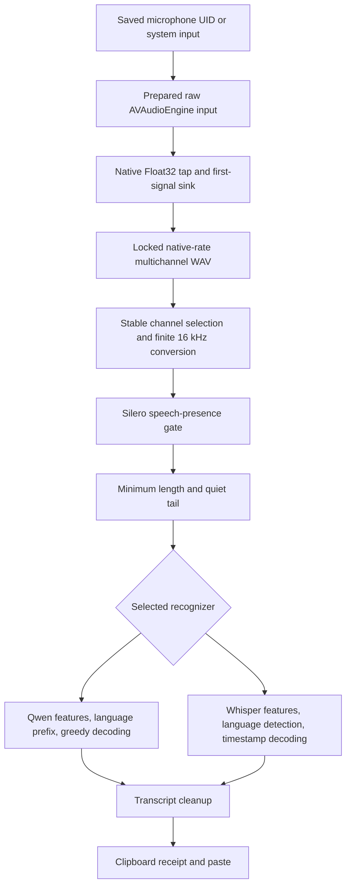

# Dictation audio pipeline investigation

> The October 23 autonomous follow-up below replaces the SDK channel mix and
> finite-file loader in the approved local diagnostic build, installed at 16:40
> PDT (see the incident history). The original synthetic matrices
> describe the pre-loader baseline. They are retained as the measured reason
> for the change, not a description of the candidate's conversion behavior.

October 23, 2026. Scope: source-to-text correctness across built-in, Bluetooth,
and USB inputs. This is an investigation record, not a claim that real-speech
accuracy is fixed. Runtime observations and consented-sample findings are in
[the incident history](dictation-startup.md).

## Findings

The user reports better results with the Mac microphone than with Yealink BH74
or AirPods. Explicit built-in selection was verified by stored UID and the
installed process's binding log. Both Qwen and Whisper still substituted words
on built-in speech. No paired accuracy rate can be inferred from these few
separately spoken attempts. Headset quality alone does not explain the report.

The synthetic digital path preserves content at the rates used by these inputs.
Native WAV round trips at the four tested 16-48 kHz rates preserve every
Float32 sample and channel. Both models
recognized the complete synthetic reference in all 36 runs: three input rates,
two gains, three repetitions per model. This does not test microphone capture,
room acoustics, real-speech intelligibility or the long-running installed runtime.

Two conversion limitations are reproducible: opposite-phase channels cancel in
the current mono mix, and the finite-file resampler does not always drain the
last samples. Neither has been established as the cause of this user's
single-channel speech substitutions. Missing timestamp and signal-quality
measurements prevented attributing live errors. The candidate adds those
measurements without retaining waveform samples or transcripts in logs.

## Current source-to-text path

| Stage | Source and established behavior | Remaining limitation |
|---|---|---|
| Device choice | `DictationInputRoute.resolve` validates the UID and live input capabilities, otherwise a usable system input | Explicit choices stay pinned; topology and selected-device properties are observed independently |
| Hardware graph | `AVDictationInputGraph` installs a nil-format tap, reads its actual format and uses a sink to pull input | Input is coupled to AVAudioEngine I/O configuration, including output changes |
| Startup and stop | Worker serializes operations, bounds pre-signal restarts, rejects interruptions after signal, drains before recognition | A PCM buffer or first nonzero sample is not proof of stable Bluetooth readiness |
| Native PCM | `DictationAudioFile` writes Float32 at the tap rate/channel count, preserves channel samples, rejects late writes | Before this candidate it ignored sample times and accepted nonfinite samples |
| Mono and rate conversion | `DictationAudioLoader`, stable channel chosen by non-DC energy, high-quality finite AVAudioConverter drain | The original SDK behavior is retained only as a benchmark baseline |
| Speech gate | Silero state resets per clip, scans until speech is found and returns a Boolean | It neither denoises nor repairs speech; it does not trim or rewrite the input |
| Model input | Both receive mono 16 kHz, at least one second, with 0.5 s trailing silence | Synthetic correctness does not establish real-input quality |
| Qwen | Fresh decoder cache per chunk, language preference only before transcript text, bounded greedy decoding | Previous error merged repeated-token and total-token limits |
| Whisper | Verified pinned assets, explicit speech task and timestamp decoding | A completed decode can still substitute words |
| Delivery | Text cleanup and paste follow recognition; logs verify clipboard consumption | This stage cannot repair recognition errors; successful paste is not accuracy |

## Device-dependent behavior

| Input route | What must be established from the actual stream | Appropriate handling |
|---|---|---|
| Built-in Mac microphone | Logical tap channels/rate, selected physical device, actual levels and active processing | Preserve the actual native format; do not assume that a physical mic array means multiple exposed channels |
| Direct Bluetooth headset | Post-start rate/channels, zero stream versus missing buffers, configuration changes, packet/timestamp continuity, hardware mute | Start in the actual negotiated format, rebuild only before accepted signal, retain a finite restart budget; do not relabel playback-rate samples as microphone-rate PCM |
| USB headset or interface | Actual clock/rate, channel map, active speech channel, mute and reconnection | Respect the device rate, map an input channel deliberately; arbitrary summation can erase speech or include an unrelated channel |
| Vendor USB radio adapter | The Mac-facing USB stream and the headset's own radio/DSP path | USB transport metadata does not prove that the headset itself is wired |
| Virtual or aggregate input | Which source feeds each channel and clock, format changes and discontinuities | Treat it as an explicit route; do not infer a physical microphone from its name |

Apple documents that an engine hardware rate/channel change stops the engine
but leaves previous connections/formats attached. Rebuilding on the capture
queue avoids teardown inside Apple's internal callback queue.
[Apple configuration-change contract](https://developer.apple.com/documentation/avfaudio/avaudioengineconfigurationchangenotification).

Apple also documents reduced Bluetooth output quality when the headset
microphone is active. This supports treating capture readiness and playback
as separate transitions; it does not establish that severe input corruption
or inaccurate transcripts are normal.
[Apple Bluetooth audio modes](https://support.apple.com/en-gb/102217).

The M5 MacBook Air specification lists a three-microphone array with directional
beamforming. That is a hardware capability, not proof of which DSP is active
in this raw input graph or an assurance that every headset must perform worse.
[Apple M5 MacBook Air specification](https://support.apple.com/en-us/126320).
Microphone modes can differ by application/route; the current app's active mode
has not been measured. Do not infer it from another app or a probe bundle.
[Apple microphone modes](https://support.apple.com/en-gb/guide/mac-help/mchle82b42f0/27/mac/27).

## Other implementations, source inspection only

[VoiceInk CoreAudioRecorder, pinned source](https://github.com/Beingpax/VoiceInk/blob/22e5ec5479b712797c3b338fcb875961e58800b6/VoiceInk/Infrastructure/Audio/CoreAudioRecorder.swift)
uses input-only AUHAL, disables output, binds the physical input, validates its
nominal rate before reusing prepared state, maps channels, and queues copied
input into bounded processing slots with drop counters. This is evidence of
an alternative architecture, not measured superiority on this machine.
Apple's AUHAL diagram and API contract place capture on output scope of input
element 1 and distinguish it from output element 0. The client and hardware
rates must match; later resampling is a separate operation.
[Apple TN2091](https://developer.apple.com/library/archive/technotes/tn2091/_index.html).

[TypeWhisper AudioRecordingService, pinned source](https://github.com/TypeWhisper/typewhisper-mac/blob/cda5bf73b074287e6a4c4c11ed4eb49a74fb4a75/TypeWhisper/Services/AudioRecordingService.swift)
distinguishes input readiness, buffer arrival and signal, normalizes multichannel
input before conversion, and feeds each converter slice once. It has a specific
voice-processing branch for a three-channel built-in default input and separate
input-only capture support. Those conditions cannot be generalized to every Mac
or copied as a universal fix. Its comments about strongest-channel selection
are not proof of which channel contains the desired speaker in our application.

[Whisper's reference audio loader](https://github.com/openai/whisper/blob/main/whisper/audio.py)
uses mono 16 kHz and Float32 waveform values; our final model-input shape agrees.
The reference does not make a Bluetooth input rate equal to 16 kHz at hardware
startup. Each runtime still owns its own feature extraction.

## Synthetic signal matrix

The production WAV writer received 1.25-second two-tone signals, 437 Hz at 0.2
and 1,223 Hz at 0.06, in fragmented PCM buffers. Tests read through the actual
WhisperKit loader. Seven rates (8, 16, 24, 44.1, 48, 96 and 192 kHz) crossed
five channel arrangements: mono, equal stereo, opposite stereo, right-only
stereo and equal three-channel input. Three-channel fixtures explicitly used
a discrete channel layout; the first harness attempt incorrectly used a
standard-format initializer that returned nil and was corrected before the
35-case measurement. No microphone or speaker was used.

All 35 native files preserved their input rate, channel count and frame count.
Interior waveform comparison for noncancelling 8-48 kHz cases had RMS error
below 0.000002. All seven opposite-phase cases became exact zero after mono
mixing even though both source channels contained signal. The current mix also
normalizes the summed peak; this does not rescue exact cancellation.

| Native mono rate | Expected 16 kHz frames | Loader frames | Missing duration |
|---|---:|---:|---:|
| 8 kHz | 20,000 | 20,000 | 0 ms |
| 16 kHz | 20,000 | 20,000 | 0 ms |
| 24 kHz | 20,000 | 19,797 | 12.69 ms |
| 44.1 kHz | 20,000 | 19,691 | 19.31 ms |
| 48 kHz | 20,000 | 19,797 | 12.69 ms |
| 96 kHz | 20,000 | 19,968 | 2 ms |
| 192 kHz | 20,000 | 19,968 | 2 ms |

A separate finite-input AVAudioConverter control supplied samples once, signaled
end-of-stream and drained until end-of-stream. It returned exactly 20,000 frames
at all six measured rates (16-192 kHz), confirming that the missing tail is not
required by the API. Apple describes the need to manage converter input and
output statuses for finite streams.
[Apple TN3136](https://developer.apple.com/documentation/technotes/tn3136-avaudioconverter-performing-sample-rate-conversions).
Both the SDK and the separate control attenuated the test tones at 96/192 kHz;
therefore that amplitude change cannot be attributed to the SDK wrapper alone.
No USB hardware at those rates was tested. The small tail loss does not explain
substitutions throughout a multi-second single-channel phrase.

## Synthetic recognition matrix

Milena synthesized the supplied reference, independently converted to 16, 24
and 48 kHz. Each rate was written through the production PCM writer at gains
1 and 0.05. The actual DictationEngine ran Qwen and Whisper three times per
case with ru/en language preferences and cloned, verified installed assets.
All 18 Qwen and all 18 Whisper outputs matched the complete reference word
sequence after case, punctuation and е/ё normalization. No decoding guard
fired. The initial ANE preparation of the clone was observed in a process
sample; its preparation time is not an inference timing measurement.
This is one synthetic voice and phrase, not a speaker/device accuracy benchmark.

## Candidate changes and verification

`DictationAudioMetrics` now summarizes native channel energy/peaks, zero/clipped/
nonfinite samples, sample-time gaps/overlaps and unavailable/invalid timestamps.
The tap forwards its actual AVAudioTime through the relay into the sink.
Unavailable time is recorded as unknown, never continuous by assumption.
A diagnostic gap is reported, not filled or removed. Native file finalization
and normalized model input log aggregate numbers only. Input preparation logs
the resolved transport, route selection and format without device names, UIDs
or speech. Resolved-device metadata is not an independent witness of which
physical microphone supplied frames.

Nonfinite PCM is now rejected before writing and before speech/model inference.
A standalone regression compiled against the real pre-change writer failed
nine assertions across NaN and both infinities; the same harness passed after
the guard. Permanent tests cover this rejection, per-channel statistics,
timestamp forwarding through the real relay, unknown/rate-mismatched time,
unchanged samples and exact native WAV round trips across twelve format cases.
Qwen errors now distinguish repetition from total-token exhaustion in local
logs, without logging token identities or text. The user-facing error remains
unchanged. These are safeguards and evidence collection, not a claimed cure
for the observed phonetic substitutions.

## Next causal checks

Use the candidate's aggregate metrics during ordinary user-triggered dictation
before changing DSP or the user's system input gain. Compare native and normalized
levels, clipping, zero runs, channels and continuity. Input gain readback alone
is not a measurement of spoken-signal level. If the native stream is damaged,
compare the same device against independent input-only capture. If native PCM
is intact but normalized signal is damaged, replace the converter/mix seam with
a finite-input, explicitly mapped implementation and reproduce the failure first.
If both are intact, compare recognizers on the identical consented clip rather
than separately spoken phrases. A new retained voice sample still requires
separate consent. Do not silently enable voice processing, raise decoder limits,
apply normalization or noise suppression, or switch to AUHAL merely because
another project does so.

The local maintenance gate completed with exit 0: 320 tests, 16 opt-in tests
skipped, 304 passed, followed by the signed development bundle. The timestamp
regression also rejected a mutation in a disposable source copy that replaced
the forwarded sample time with nil (baseline exit 0, mutant exit 1). Aggregate
receipts are retained under
`~/.local/state/agent-artifacts/translate-like-me/pipeline-20261023T195026Z/`
while the live diagnosis remains unresolved. Temporary synthetic audio, model
clones and research probes were removed. No new personal recording was made
for this pipeline investigation. After separate user approval, the diagnostic candidate was installed and
restarted. Its signature and new binary hash were verified, and the complete
preference profile and dictation asset metadata matched their pre-replacement
snapshots. Qwen reached Ready with system input resolving to the built-in
48 kHz mono microphone. The exact installed artifact and verification state are
recorded in
`~/.local/state/agent-artifacts/translate-like-me/install-diagnostics-20261023T195817Z/receipt.json`.
Ordinary dictation with these diagnostics remains to be checked.

## Autonomous follow-up and decision

The user explicitly asked to finish the research, make the implementation
choice and test without asking them to dictate again. The comparison scope is
Wispr Flow, Superwhisper, Aqua Voice, VoiceInk and TypeWhisper. This is a
comparison of documented behavior and inspectable implementations, not an
independent ranking of commercial recognition accuracy. No account was created,
no paid service was called, and no voice was uploaded to a competing product.

| Product | Verified source | Relevant behavior and limit |
|---|---|---|
| Wispr Flow | [Microphone selection](https://docs.wisprflow.ai/articles/8884408990), [quality troubleshooting](https://wisprflow.ai/post/transcription-quality) | Explicit input/ranking, warnings about Bluetooth startup, independent-recorder check, distinction between audio problems and model changes; capture internals are not established by these documents |
| Superwhisper | [Microphone and system-audio troubleshooting](https://superwhisper.com/docs/common-issues/microphone-and-system-audio), [benchmark method](https://superwhisper.com/docs/models/benchmarks) | Explicit/prioritized microphone choice and built-in input with headset output; its measured WER/latency figures are distinct from hand-assigned model ratings |
| Aqua Voice | [Microphones](https://aquavoice.com/guide/recommended-microphones), [startup delay](https://aquavoice.com/guide/how-to-fix-microphone-delay) | Documents built-in versus Bluetooth tradeoffs and cold-start delay; its microphone ratings are vendor guidance, not our measured device scores |
| VoiceInk | [Audio input](https://tryvoiceink.com/docs/audio-input), pinned capture source above | Explicit choice/fallback ordering and separate pause/mute controls; inspectable input-only AUHAL/channel-map implementation |
| TypeWhisper | Pinned recording/recovery source above | Separate readiness and signal tracking, per-slice consumption and channel normalization; specialized branches are not universal device policies |

The Superwhisper documentation screenshot was opened: it shows a system-default
option, a selected MacBook microphone, a priority star and other headset entries.
This verifies the depicted selector, not the current implementation's private
audio engine. Superwhisper's benchmark methodology uses identical clips and WER
rather than a demonstration phrase; its datasets are not the two-voice synthetic
corpus used here. Vendor benchmark rankings therefore do not establish our
Russian real-speaker accuracy.

### New live evidence without another user test

The installed diagnostic build recorded an ordinary hold at 15:08 PDT. Its
native stream was mono 48 kHz with 888,000 written frames, no sample-time gaps,
o overlaps, no invalid samples and no clipped samples. Native RMS/peak were
0.038600/0.288173; normalized RMS/peak were 0.038599/0.287948. The SDK returned
295,936 rather than the duration-equivalent 296,000 samples, a four-millisecond
tail difference. Thus gross clipping, a large gain change and the measured
sample-time discontinuities were not present in this particular hold. These
aggregate readings cannot establish intelligibility, SNR, absence of microphone
DSP artifacts or recognition correctness. Its voice was neither copied nor saved
by this investigation.

A separately signed metadata-only probe exercised the production input graph,
with its relay instrumented in a disposable source copy to collect metrics in
memory. It never created a recording sink, played sound or retained PCM. Core
Audio exposed one eligible built-in input to this probe. Three fresh graphs and
three repeated starts on a prepared graph all delivered at least 0.25 seconds
of native 48 kHz mono buffers and stopped afterwards, six of six. No rate changes,
gaps, overlaps, clipping or invalid samples were counted. The system input was
unchanged. Bluetooth and USB were not physically covered by this enumeration;
future reports must distinguish simulated format/recovery coverage from physical
headset coverage. This graph-only check does not exercise worker output-mute or
media commands and is not a speech-quality test.

### Implementation choice

Keep raw, stopped-between-holds capture with bounded startup recovery and the
explicit microphone choice. The available live stream is continuous; moving
the whole backend to AUHAL is not justified as the cure for the observed lexical
errors. Do not automatically override a selected headset, enable voice processing,
change system input gain or insert an LLM cleanup step. Those would change
approved behavior without establishing a cause.

Own the conversion boundary instead of relying on an SDK convenience loader.
`DictationAudioLoader` preserves a single microphone channel for the entire
utterance, chooses it by energy after subtracting the DC contribution, feeds
finite PCM to AVAudioConverter once, signals end-of-stream and drains until
completion. It retains native samples and performs no gain normalization or
noise suppression. Normal conversion at medium quality preserves the measured
legacy filter through 48 kHz. Above 48 kHz, maximum quality avoids the measured
in-band attenuation at 96/192 kHz. A fractional final output frame may
round by one sample; substantial truncation or excess fails instead of being
padded or trimmed silently. General multichannel meeting/file transcription is
outside this single-speaker dictation policy: an unrelated noisy channel can
still require a deliberate channel map.

The new regression tests first ran against a wrapper around the actual previous
SDK loader and failed eight assertions across duration, opposite-phase and DC/
active-channel cases. After implementing the owned boundary, all three original
regressions passed. A first amplitude assertion incorrectly included the sinc
converter's ringing at an abrupt synthetic file boundary; it was corrected to
measure the steady interior tone, without widening its amplitude tolerance.
Additional checks cover fractional lengths, high-rate input, fixed channel choice
within an utterance and empty input.

The persistent autonomous checker is `python3 scripts/check-dictation-pipeline.py
--work <unique-task-directory>`. It creates synthetic speech, clones the installed
model cache with APFS copy-on-write, injects fixed ru/en preferences and verifies
that unchanged 16 kHz mono control samples remain bit-identical. The four arms
are the previous loader, only channel choice, only the finite converter, and the
complete candidate. Channel-only ablation uses the fixture's known intended
channel with the previous converter; converter-only ablation calls the SDK's
actual prior mono mixer before the candidate converter. No inference or network
upload uses the installed profile's model files directly. The runner writes
progress after each fixture and inference and can resume an unchanged case set;
source and fixture hashes reject stale comparisons. Case-level word-error totals
and a sign test are descriptive for this small shared-source corpus, not an
accuracy estimate for natural speech or a claim of independent statistical power.

### Converter experiment and regression gate

The first four-arm comparison used mastering conversion at maximum quality at
all rates. Its 240 results exposed a regression that the aggregate score alone
would hide: Whisper substituted one word in all three English control repeats.
Channel-only conversion preserved that control, while converter-only and the
complete candidate changed it. Both models recovered the opposite-phase phrase
only when channel selection changed. That localizes the new English regression
to conversion on this corpus; it does not attribute the user's original errors.
The mastering policy was rejected rather than justified by the larger total
improvement.

A separate 12-cell synthetic tone experiment crossed Normal/Mastering algorithms,
default/maximum quality and 48/96/192 kHz. At 48 kHz all retained approximately
0.2 peak amplitude. Normal/default quality attenuated the 96/192 kHz tone to
0.19779/0.152738, while Normal/maximum retained approximately 0.2. The candidate
therefore preserves Normal/medium at common microphone rates and raises quality
only above 48 kHz. Seven loader tests, together with eleven native writer tests,
passed. Disposable source mutations that force channel zero, skip EOF drain or
restore medium quality at high rates each fail the actual writer/loader checks;
the unchanged candidate passes. The sum-channel mutation was also rejected in
the initial experiment. No production source was mutated in place.

### Final autonomous comparison

The revised Normal/medium-through-48-kHz candidate completed all 240 recognition
attempts: ten synthetic cases, four arms, two models and three repetitions.
All attempts returned normally. Word-error totals across each arm's 30 results:

| Model | Previous SDK | Channel choice only | Finite converter only | Complete candidate |
|---|---:|---:|---:|---:|
| Whisper large-v3-turbo | 36 | 0 | 36 | 0 |
| Qwen3-ASR | 36 | 0 | 36 | 0 |

All 54 candidate speech results matched the reference words; all six candidate
silence results were empty. There were no worsened cases. The 16 kHz mono
control arrays were bit-identical between loaders. The improvement is localized
to the opposite-phase case by the four-arm experiment; the finite converter
preserves duration but has no demonstrated word-accuracy benefit on this corpus.
Each model improved one case, tied nine and worsened none; the two-sided sign
test is p=1. Repeated variants share the same two synthetic voices, so these
results are not 54 independent natural-speech observations and do not establish
headset accuracy or a broad model ranking.

After recognition completed, the report checker was strengthened to fail for
any candidate case regression or recognizer exception, even if an aggregate
score improves or a failed silence case happens to return empty text. Reanalysis
of the stored rejected-mastering experiment reports failure, while the final
experiment passes. An injected exception on a silence row fails; a removed row
is rejected as incomplete. This reanalysis does not count as additional model
inference. Recognition-time source hashes and the original runner are retained
separately from the strengthened report code.

The full Swift suite ran 328 tests: 311 passed, 17 opt-in tests were skipped,
zero failed. The explicit 240-result comparison was run separately; its opt-in
skip in the default suite is not counted as comparison coverage. Physical
coverage remains six graph starts on the built-in microphone only, without
voice retention. No Bluetooth/USB near-end speech, hardware mute toggle,
installed-app end-to-end delivery or real-speaker WER was newly verified.

Aggregate receipts, both experiment summaries, source hashes, converter
ablation, mutation results and report-check controls are retained under
`~/.local/state/agent-artifacts/translate-like-me/autonomous-pipeline-20261023T232754Z/`.
Synthetic waveforms, private model clones and probe applications are temporary
and are removed after validation. The actual cause of the reported natural-speech
substitutions remains unresolved; no expiry is assigned to these receipts.

## Device compatibility follow-up

The later same-day investigation addresses device identity, topology changes,
explicit binding, input liveness and drain-time races separately from ASR word
accuracy. Reproductions, implementation, the 28-format matrix, native observer
and preparation checks, and uncertified hardware cases are recorded in
[microphone compatibility](dictation-device-compatibility.md). This later local
candidate is separate from the loader-only build installed at 16:40 PDT.
