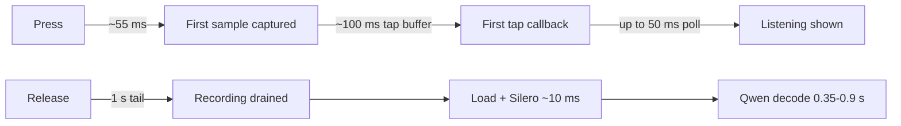

# Dictation latency

October 22, 2026. The user asked for the shortest possible wait before
Listening and faster recognition. Constraints from earlier decisions stay:
no microphone between holds, raw input without voice processing
([startup investigation](dictation-startup.md)).

## Where the time went

Read-only logs of the installed app (Qwen selected, built-in microphone)
showed, per dictation: `engine.start()` 61-74 ms after the press, then the
fixed one-second release tail, then 2 ms of audio loading, up to 10 ms of
Silero, and 0.35-0.9 s of Qwen decoding on an unloaded machine.

## Microphone start

A signed development probe (`com.wiltodelta.translatelikeme.dev` bundle id,
hardened runtime, audio-input entitlement) on the built-in MacBook Air
microphone ran each mode in two separate processes, ten holds each, alternating
order. It recorded host times only, no audio.

| Mode | Start call | First sample (host time) | First callback | Buffer |
|---|---|---|---|---|
| Prepared AVAudioEngine, input tap (shipped) | 58 ms | 55 ms | 163 ms | 4,800 frames |
| AVAudioSinkNode | 52 ms | 49 ms | 61 ms | 512 frames |
| AUHAL, input only, initialized ahead | 37 ms | 34 ms | 46 ms | 512 frames |
| Tap and sink together | 58 ms | - | sink 66 ms, tap 162 ms | both |

The shipped path already captured from about 55 ms; the tap's 100 ms buffer,
plus the 50 ms meter poll, delayed Listening to about 0.2 s. Every mode read
process input-running zero before each hold.

Implemented: the prepared engine also connects its input to an
`AVAudioSinkNode` that only marks the hold's sink once a nonzero sample
arrives (`DictationTapRelay.hear`, lock-free flag in `DictationAudioFile`); the
tap still writes the recording, and its first write marks the sink too. The
controller polls every 10 ms until Listening, then reads the level every 50 ms;
after the first audio the sink callback skips the relay lock. The exact production worker sources, compiled
into the same kind of signed probe with the output mute disabled through the
argument domain, gave 30 of 30 holds over three processes: first audio median
61 ms, range 51-67 ms (previously 175-179 ms median). Every WAV finalized at the
expected length. AUHAL would start about 20 ms sooner but replaces the whole
engine path, its format and route handling included; it was not adopted.
AirPods and USB inputs were not measured with the sink.

## Release tail

The tail kept recording a full second after every release. It now ends once
the recording has been quiet for 300 ms and at least 200 ms have passed since
release (the tap's buffers arrive about 100 ms late), capped at the same
second. Quiet means a 100 ms buffer within 9 dB of the hold's quietest buffer,
and the hold must have a buffer at least 15 dB under its loudest; without that
contrast (a silent room, or speech with no pause) the tail runs in full. The
first buffer never sets the floor, since it can carry start-up zeros. A last
word still being spoken keeps the buffers loud, so the tail continues.

This was verified by unit tests with injected levels and sleeps only. The
thresholds have not been checked against real speech in different rooms; each
release logs `Dictation release tail N ms` to check them on real dictations.

## Qwen decoding

A temporary release-mode XCTest loaded the pinned Qwen export from an APFS clone
of the installed cache and decoded three synthetic `say` clips (Milena, Samantha:
3.3, 4.4 and 15.7 s). Other applications kept the machine loaded, so only paired
comparisons inside one process are used.

Pipelining: once no language preference can apply (`DictationLanguagePrefix.reach`),
the next step is queued on the GPU before the current token is read. Two
processes, ten interleaved rounds each: faster in 44 of 60 pairs (two-sided sign
test p < 0.001), median 24.6 to 21.6 ms per token. Median savings were 8-13% on
the 30- and 77-token clips and none on the 14-token one. Every transcript was
identical across variants. Keeping MLX's buffer cache between dictations showed
no consistent gain and doubled cached memory; it was not adopted.

Warm-up: `DictationQwen` now runs one second of silence through the encoder,
prefill and one decode step after loading. Over eight fresh processes,
alternating, the first recognition took 367-404 ms with warm-up and 406-434 ms
without, except 724 ms in the first process after a rebuild, when the system
shader cache was cold. Whisper large-v3-turbo showed no first-recognition penalty in two
fresh processes, so it gets no warm-up.

Probe sources and metadata-only JSON lived in a task temporary directory and
were removed; the verdicts above are the record.
