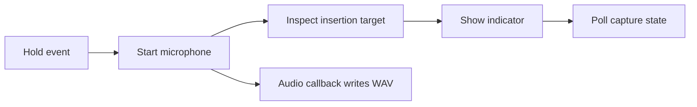

# Dictation startup latency

Investigation started October 19, 2026 after the user reported losing the
beginning of speech when speaking immediately after the hold key. Fast capture
is a product requirement; recognition speed is a separate measurement.
The user explicitly chose microphone capture only while the key is held.
Continuous capture and a pre-press RAM buffer are excluded from the authorized
implementation. Prepared states must not capture input between holds.

## Findings in the current path

`HotKeyManager` receives local/global NSEvent callbacks on the main actor and
calls `DictationController.shortcutPressed`. Capture previously inspected the
other app through Accessibility and constructed the indicator before calling
`DictationRecorder.start`. These cross-process AX reads were an avoidable
dependency before microphone startup.

The controller now starts the recorder and registers its completion handler
before inspecting the insertion target. `testMicrophoneStartsBeforeReadingTheInsertionTarget`
exercises the real controller path with injected effects: it failed on the old
order and passes on the new order. It also asserts that the target lookup
actually ran. This establishes ordering, not a measured millisecond improvement.

Further startup work remains in `DictationRecorder.startEngine`: creation of a
new engine, enabling VoiceProcessingIO, reading its new client format, creating
the silent output graph, opening the WAV, installing the tap and starting the
engine. All this currently executes synchronously on the main actor for each
hold. Teardown stops the engine and disables processing to release media
ducking. Its relative costs have not been measured in this investigation.
Because the hold monitor also runs on the main actor, synchronous engine
startup can postpone observing a physical release. A direct unit call to
`shortcutReleased` after `shortcutPressed` returns does not simulate that
interval. A worker prototype must handle release/cancel during setup and check
its generation before starting hardware, rather than queue a late microphone
start after the user released the key.

Whisper model loading is already outside the press-to-capture path. If the
model was evicted, recording starts first and reload happens after release.
Optimizing model loading cannot repair audio lost before capture starts.

The recording-state meter runs every 50 ms. That poll can delay the visible
state transition after audio already arrives. The current 1,024-frame tap
request is not a guarantee of actual callback size or frequency, so a smaller
number alone is not evidence of faster capture.

## Candidate approaches

| Approach | Benefit to test | Limits and acceptance checks |
|---|---|---|
| Start capture before AX and presentation | Removes editor responsiveness from the path before recorder startup | Implemented ordering change; hardware effect unmeasured |
| Preconfigure a stopped engine and call `prepare()` outside the hold | Moves graph allocation away from the press | Verify actual microphone/ducking state before the hold; do not assume preparation is free of hardware effects |
| Retain a prepared engine with `pause()` between holds | Apple documents retained prepared resources | Hardware still restarts; route changes invalidate formats; retaining voice processing must not keep media attenuated |
| Run capture continuously, retain a short RAM ring buffer and gate each utterance | Removes per-hold hardware restart and can retain speech immediately before the event | Rejected by the user: microphone must be active only while the key is held |
| Move engine ownership to a serial audio worker | Keeps UI and release/cancel event handling responsive | Dispatching existing startup work does not make hardware ready sooner; design generation checks so release/cancel cannot lose a pending recording |
| Use an `AVAudioSinkNode` and a preallocated transfer buffer if tap delivery dominates | Receives input under real-time constraints | No file I/O, blocking locks, allocation or dispatch in the render callback; more complexity, justified only by measured callback delay |

Selected direction: preserve hold-only capture, measure the stages, then test
prepared/pause variants against the existing teardown behavior. Do not build a
continuous-capture prototype under the current authorization.

The rejected alternative was a proposed 300 ms RAM ring buffer. That value was
not measured and no such buffer was implemented. Software cannot recover
speech that occurred before an inactive microphone began capturing it; the
selected direction must reduce actual startup delay rather than promise
recovery through a pre-press buffer.

The current public ducking configuration lists minimum, medium, maximum and
default levels, not an off level. `enableAdvancedDucking = false` disables
voice-activity-based ducking, not attenuation itself. The SDK's older
`kAUVoiceIOProperty_DuckNonVoiceAudio` is deprecated and unavailable on macOS;
it is not a supported workaround. Continuous VoiceProcessingIO therefore needs
an explicit idle-playback experiment, not a promise that muting the uplink
restores the movie's volume.

## Measurement contract

Record only monotonic timestamps, device/format metadata, frame counts and
state transitions. Never collect user audio or transcripts for a timing report.

Capture these boundaries separately:

1. Original NSEvent timestamp, callback entry and accepted hold. A busy main
   actor can delay event handling before `shortcutPressed` even runs.
2. Recorder entry, voice-processing configuration completed, graph/file ready,
   engine start entered and engine start returned.
3. First nonempty callback arrival, its first-sample host timestamp when valid,
   and the successful first write. Continue writing the complete first buffer.
4. Visible recording transition, release event and teardown completion.

`AVAudioTime.hostTime` uses `mach_absolute_time`. Convert compatible timestamps
on that clock, check validity and preserve unavailable marks. First callback
arrival is not the timestamp of the first captured sample. Buffer aggregation
can delay delivery without losing the beginning, so a callback timer alone
cannot establish clipping. Conversely, `engine.start()` returning does not
prove any audio has arrived. A lighted indicator proves neither.

Use a serial matrix on the same build and device pair: current teardown,
prepared stopped graph and pause/resume, with cold start and repeated holds.
Separate built-in input, wired/USB and Bluetooth routes. Repeat after idle,
sleep/wake and route replacement, and under ordinary load. Start with 30 trials
per condition for diagnosis, report success counts, median, p95, maximum and
sample size, and collect more before making a tail-latency promise. Compare
paired per-trial differences and a sign test; vary one factor at a time.

Verify quick release while startup is pending, cancellation before the first
buffer, replacement of the input device, failures and microphone permission
loss. Every arm must restore playback after stop, cancel and failure. Test idle
playback too for prepared and continuous variants. Do not parallelize these
timings with other agents' hardware or performance measurements.

For first-word preservation, use a synchronized known source that begins at
several offsets around the hold event, and compare the actual retained samples
and first word. A signal rendered by this Mac's own speakers may be removed by
echo cancellation, so it cannot by itself stand in for independent foreground
speech. Offline sink and recognizer tests do not establish hardware startup
latency or physical voice preservation.

## Verification and remaining work

The order regression failed before the change; all 12 controller tests passed
after it. The before/after logs are `.build/dictation-start-order-before.log`
and `.build/dictation-start-order-after.log`. The full gate exited 0 with
167 tests passed, nine skipped, and a signed arm64 development bundle built;
its log is `.build/dictation-startup-maintain.log`. These are software checks,
not a physical startup benchmark.

No physical microphone timing or acoustic experiment ran in this investigation.
The signed development app's native checks are pending: another session owns
the shared Rota desktop notice, and the standalone command-line test host has
not been granted microphone access. No new permission prompt was requested.
Do not describe startup as instantaneous or assign a latency gain from these
software checks. The Antigravity picker report remains separately open in
[release validation](release-3.7.2.md#antigravity-model-picker-report).

## Primary references

- Apple, [prepare](https://developer.apple.com/documentation/avfaudio/avaudioengine/prepare()): preallocates resources for responsive startup.
- Apple, [pause](https://developer.apple.com/documentation/avfaudio/avaudioengine/pause()): stops hardware while retaining prepared resources.
- Apple, [start](https://developer.apple.com/documentation/avfaudio/avaudioengine/start()): starts audio hardware and prepares implicitly if needed.
- Apple, [WWDC19, What's New in AVAudioEngine](https://developer.apple.com/videos/play/wwdc2019/510/): voice-processing changes require a stopped engine; sink callbacks have real-time constraints.
- Apple, [installTap](https://developer.apple.com/documentation/avfaudio/avaudionode/installtap(onbus:buffersize:format:block:)): the implementation may choose another buffer size.
- Apple, [AVAudioTime](https://developer.apple.com/documentation/avfaudio/avaudiotime): host and sample timestamps with independent validity.
- Apple, [ducking configuration](https://developer.apple.com/documentation/avfaudio/avaudioinputnode/voiceprocessingotheraudioduckingconfiguration): advanced ducking and attenuation levels.
- Local Xcode 27 SDK, `AudioToolbox/AudioUnitProperties.h`, AUVoiceProcessing deprecated properties: `kAUVoiceIOProperty_DuckNonVoiceAudio` is unavailable on macOS.
