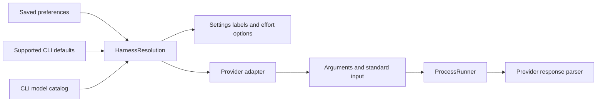

# Provider support

Translation and Rewrite share the selected engine, model and effort. Dictation
has its own local speech models and does not use a CLI provider. There is no
automatic failover to another service: a failure never changes where text goes.

## Configuration contract

`HarnessResolution` is the source of truth for Settings and CLI launches. It
resolves application preferences, supported CLI configuration defaults, and the
catalog's reported default in that order. Its `choice` contains launch flags;
its `model` describes the expected model. A catalog default can validate effort
without becoming a pinned `--model` argument. When the actual CLI default is
unknown, it remains unknown.



Effort capabilities have three states: `nil` means unknown, an empty list means
confirmed unsupported, and a nonempty list contains accepted values. A missing
or unreadable catalog must not be treated as proof that effort is unsupported.
Known incompatible effort is omitted from a run, with an explanation in Settings.
The saved preference remains intact and becomes effective again if a compatible
model or catalog returns. Antigravity cannot receive effort without an explicit
model; selecting Default suppresses the flag without erasing that preference.

## Adapter boundaries

`CLIEngines.swift` contains one explicit adapter per CLI. Each constructs an
inspectable `CLIInvocation`; process lifetime, cancellation, sanitized environment,
output cleanup and error presentation use the existing shared helpers. Selection
text travels on standard input, never in process arguments. A successful exit
with an unrecognized response format is an error, never text to paste.

| Engine | Catalog and defaults | Isolation | Local CLI history |
|---|---|---|---|
| Claude Code | Account catalog, fallback aliases; `settings.json` model and effort | User settings, tools and MCP disabled | Disabled |
| Codex | Model cache; top-level `config.toml` model and effort | User config and execpolicy rules disabled; tools disabled, read-only sandbox; global instructions still apply | Disabled |
| Grok Build | Model cache; reported default from `grok models`; CLI reads its own config | Compatibility imports, memory and workflows disabled; tool allowlist blocked | May persist |
| Antigravity | Latest `agy models` probe; CLI-selected default is unknown to the app | App-owned agent and workspace, inherited customizations and MCP disabled | Persists |
| Local model | Pinned `LocalModel` definitions | In-process, offline after download | No CLI |

Claude configurations that reroute to another provider and Codex custom providers
are not inherited. Codex profiles are not followed. Only the supported defaults
are copied into isolated CLI runs, so Default is not a promise to reproduce every
setting of an interactive CLI session. Model availability and account limits
remain the CLI's responsibility.

## Codex global instructions

The [configuration reference](https://learn.chatgpt.com/docs/config-file/config-reference)
documents `project_doc_max_bytes` as the project-instruction size limit. It does
not promise to disable global instructions. The installed CLI was checked using
an isolated synthetic `CODEX_HOME`, a global `AGENTS.md` canary, and a loopback
Responses endpoint. The request included the canary both with the default limit
and with `project_doc_max_bytes=0`. No real credentials or external API were used.

The production adapter therefore retains the user's auth home and discloses the
remaining global-instruction influence. Do not copy `auth.json` or fork refresh
tokens to hide the instructions. A future isolation change needs the same request
inspection, plus a real synthetic translation, before removing the disclosure.

## Readiness and quality

`EngineStatus` checks installation and sign-in. `EngineProbe` then runs a bounded
smoke translation, Hello to Spanish, and accepts Hola with surrounding punctuation
and whitespace. An echo, assistant reply or diagnostic does not count as working.
This establishes only that the smoke case passed, not general model quality or
Rewrite quality.

`ProviderEvaluationTests` is an opt-in matrix shared by CLI and local engines. It
covers both directions, a third language, questions, requests, greetings, writing
style, Rewrite self-corrections, a recipient question, long input and inert input.
Normal tests skip it and never contact providers. Every completed row is saved,
including failures, versions, requested configuration, raw synthetic response,
elapsed time and deterministic anchor checks. Anchor checks are screening signals;
human review must judge meaning, language, style and preserved facts. Do not rank
models using anchor counts alone. CLI defaults may have unknown model or effort;
such rows are labeled accordingly and are not comparisons of pinned models.
Each engine's launch configuration is captured once before its cases. The matrix
uses CLI configuration defaults, rather than mutable application preferences;
optional explicit choices are passed directly to the production adapter. This
prevents another XCTest process changing shared preferences during a live run.

The [reviewed baseline](evaluations/provider-baseline.json) retains every clean
synthetic answer, the exact CLI versions or model revisions, configuration,
suite fingerprint, automatic screening and manual review. Its summary is the
source of truth for counts. It is a small English/Russian comparison with a
German third-language case and a Spanish greeting, not proof of support for
every language offered by the OS language picker. TranslateGemma was absent
and was not downloaded. Antigravity uses fewer repetitions to limit retained
history. Elapsed times are not comparable because other work ran concurrently.

The baseline demonstrates differences beyond transport support: Claude sometimes
exposes routing commentary, Grok sometimes answers an embedded instruction, and
E2B can choose the wrong language, borrow a detail from a prompt example, or
collapse repeated paragraphs. It also contains correct Gemma 4 12B wording that
the keyword check rejected. These observations do not justify a universal model
ranking or an automatic change to the user's model selection.

Run the matrix deliberately, since it consumes account limits and Grok Build or
Antigravity may retain the synthetic text in their own history:

```sh
TLM_PROVIDER_EVALUATION_REPORT=/tmp/provider-evaluation.json \
swift test -c release --arch arm64 --build-system native -Xswiftc -enable-testing \
  --filter ProviderEvaluationTests
```

Optional controls:

| Environment variable | Purpose |
|---|---|
| `TLM_PROVIDER_EVALUATION_ENGINES` | Comma-separated `Provider` CLI IDs or `LocalModel` IDs; defaults to all CLI engines |
| `TLM_PROVIDER_EVALUATION_REPETITIONS` | Runs per case; defaults to three |
| `TLM_PROVIDER_EVALUATION_CASES` | Optional comma-separated case IDs from the test source |
| `TLM_PROVIDER_EVALUATION_CHOICES` | Optional JSON object mapping CLI provider IDs to `model` and `effort`; no preferences are changed |
| `TLM_PROVIDER_EVALUATION_LOCAL_BASE` | Isolated APFS clone of the translation cache, required for local engines |
| `TLM_PROVIDER_EVALUATION_METALLIB` | Built `mlx.metallib`, required for local engines |

Local evaluations never download or use the installed cache directly. Clone it
with `cp -cR`, verify the pinned model is installed in the clone, and run in a
release build. Record GPU and system load before interpreting latency. Keep
quality and latency comparisons separate; active desktop or compilation work can
invalidate a latency comparison. Long runs follow the global detached-job rules.

## CLI compatibility procedure

On a CLI upgrade or parser change:

1. Read that installed CLI's `--version` and `--help`; check the adapter's required
   flags. Keep captured protocol examples synthetic and credential-free. The
   version headers in parser tests identify the existing wire-format evidence.
2. Run `CLIAdapterTests`, `CLIStreamTests`, `HarnessModelsTests`,
   `HarnessDefaultsTests`, `SettingsStorePickTests`, `EngineHealthTests` and
   `AntigravityTests`. Adapter tests pass Settings selections through real
   subprocesses and inspect arguments, stdin, environment and returned errors.
3. Check missing or changed catalog fields, unknown models, explicit unsupported
   effort, refreshed defaults and preserved preferences. Do not infer a new
   capability from an absent field.
4. Run the opt-in quality matrix for the affected CLI, using the same cases and
   repetitions as the previous run. Review raw outputs and failures, not only
   test exit status. Keep limit and authentication failures separate from quality.
5. For an isolation change, inspect a synthetic request and verify that unrelated
   instructions, tools and integrations are absent. Never inspect or publish a
   real user's request or authentication data.
6. Build the signed dev bundle, capture the affected Settings states in light and
   dark appearances, and verify the actual picker transitions through AX.

No minimum-version assertion substitutes for these checks: a CLI may change an
internal cache or a server-side model catalog without changing the app.

## Verification evidence

The [verification record](evaluations/provider-verification.json) links the
retained captures and records the local gate, isolated first-run checks, negative
tests and synthetic isolation probe. English Settings were reviewed for every
engine in both appearances. German covers the longer Codex copy, Antigravity,
incompatible effort, unknown effort and an actual AX reset to Default. The
capture runner compares restored development preferences with its backup and
reads the restored system appearance back before succeeding.

Examples: [Codex, English](../screenshots/providers/en/provider-openai.png),
[saved alias](../screenshots/providers/en/provider-incompatible-effort.png),
[unknown effort reset, German dark](../screenshots/providers/de/provider-unknown-effort-default-dark.png).
This is focused Settings verification, not a full accessibility audit.

Use `CAPTURE_PROVIDERS_ONLY=1 CAPTURE_OUT=<temporary directory>` with the existing
`capture-screenshots.sh` through the shared native-capture notice wrapper.
`CAPTURE_LANGUAGE=de` selects German, and `CAPTURE_PROVIDER_LIST='openai antigravity'`
limits the ordinary engine states while retaining the effort regression states.
